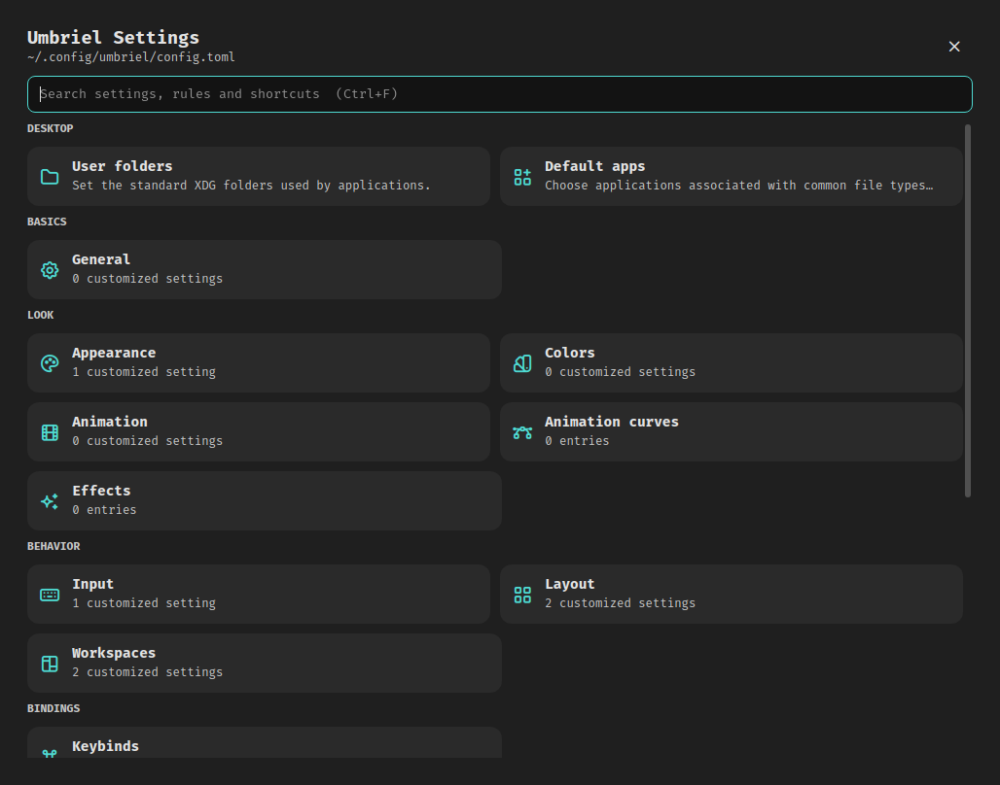

# Umbriel Settings

Edit your [Umbriel](https://github.com/noctalia-dev/umbriel) config, XDG user folders and default
applications without losing the comments and formatting of your files. Umbriel Settings comes as:

- a **standalone app** (PySide6), and
- a **[Noctalia](https://github.com/noctalia-dev/noctalia) shell plugin**.

Both share the same core and the same user interface code. The two versions look and behave alike,
and a feature added once shows up in both. The app keeps a navigation sidebar on the left, and it
does not need Noctalia.

| Standalone app | Noctalia plugin |
| --- | --- |
|  |  |

## Features

- **Every Umbriel setting**: general, appearance, colors, animation and curves, effects, input,
  layout, workspaces, keybinds. It also covers window, layer, workspace and security rules, outputs,
  scratchpads, input devices and environment variables.
- **Search everything** from the sidebar (Ctrl+F): setting names, words from their help, config keys
  (`border_width`), rule names and shortcuts. Results jump straight to the setting.
- **Clear rows**: each setting shows its control, the default value, an ⓘ button with the full help
  and config key, ↶ to undo your edit, and the eraser to remove the key so Umbriel's default applies.
  **Only customized** shows just what differs from the defaults. A rule field without a default reads
  **Any / Not set / On / Off**.
- **Rules, outputs, devices and effects** are lists. Open an entry to edit it, give rules a display name,
  reorder, duplicate or delete them. **Inspect connected outputs** adds a monitor with one of its real modes.
- **Keybinds** are grouped. Build shortcuts from modifier chips and a key, then pick an action from a
  searchable catalog with argument hints. You can also set repeat and locked options, manage groups,
  and lock shortcuts so they can't be changed by accident.
- **User folders and default apps**, with folder pickers, a searchable app list with icons, and
  per-MIME-type associations.
- **Follows your theme**: Noctalia colors, font and corner radius, or your qt6ct/KDE colors (see
  [Theming](#theming)). Numbers use your locale's decimal separator (`LC_NUMERIC`).

## Saving safely

Nothing is written until you press **Review & save** (Ctrl+S).

- The review lists every change in words and shows the file diff by section.
- **Check with Umbriel before writing** (on by default; `--no-validate` starts it off) runs
  `umbriel config validate` on a temporary copy first. If Umbriel rejects the new file, nothing is
  written and each problem links to its setting. The check is skipped when `umbriel` is not on `PATH`.
- **Tidy file layout** regroups the file in canonical order with section banners. It is on by default
  only for files that already have banners; `--no-rebuild` turns it off for good. Regrouping may move
  comments.
- A timestamped backup is made before every save or restore. **Backups** on the home page compares,
  restores and deletes them. Desktop settings are backed up separately and are not rolled back with
  the config.
- Unsaved edits are kept as a draft when you close the window and restored next time. Closing with
  unsaved edits asks first.
- If the config changes on disk while the app is open, it reloads. Your setting edits are kept; rule
  and keybind edits are dropped, with a note.
- Symlinked configs are refused; open the link's target instead.

## Requirements

Python 3.11+, PySide6 with QtWebEngine, tomlkit and lupa. The Umbriel CLI is optional (validation,
defaults and ranges, schema comparison).

```sh
# Arch Linux
sudo pacman -S python pyside6 qt6-webengine python-tomlkit python-lupa

# Debian 13+
sudo apt install python3 python3-pyside6.qtwidgets python3-pyside6.qtwebenginewidgets \
    python3-pyside6.qtwebchannel python3-tomlkit python3-lupa

# Fedora
sudo dnf install python3 python3-pyside6 python3-tomlkit python3-lupa

# Any distribution: a virtual environment (the PySide6 and lupa wheels include everything)
python3 -m venv .venv && . .venv/bin/activate
python -m pip install -r python/requirements.txt
```

Package names for lupa and QtWebEngine differ between distributions; if one is missing, use the
virtual environment.

## Run

```sh
python python/umbriel-config-gui.py [path/to/config.toml]
# or
cd python && python -m umbriel_config_gui [path/to/config.toml]
```

Without a path, it opens the config used last, else `~/.config/umbriel/config.toml`. You can switch
files at the bottom of the home page.

```text
--config PATH     Select a config file (alternative to the positional path)
--no-validate     Start with "Check with Umbriel before writing" turned off
--no-rebuild      Never regroup the file layout when saving
--check-schema    Compare the app's fields with the installed Umbriel schema and exit
--legacy-ui       Open the previous Qt widget interface (temporary)
--version         Show the version and exit
```

Keys: Ctrl+F search, Ctrl+S review and save, Alt+Left back.

### Launch with a keybind

Add it to the `[keybinds]` section of your Umbriel config, or on the app's **Keybinds** page:

```toml
"Mod+Shift+C" = "spawn /usr/bin/python3 /path/to/Umbriel-GUI/python/umbriel-config-gui.py"
```

Adjust the paths. Use `.venv/bin/python` with a virtual environment, and quote paths that contain
spaces.

### AppImage

Build a self-contained AppImage with Python, PySide6 (including QtWebEngine), tomlkit, lupa and the
shared interface:

```sh
appimage/build-appimage.sh        # writes dist/Umbriel-Settings-<version>-<arch>.AppImage
```

The build needs network access, `bash`, `python3` with `venv`, and FUSE (or
`APPIMAGE_EXTRACT_AND_RUN=1`). The Umbriel CLI is looked up on `PATH`. The installed desktop entry
points to the AppImage itself, so keep it at a stable path.

## Theming

The app uses the first of these that is available, and follows changes while it is open:

1. **Noctalia's palette**: the exact colors the Noctalia plugin uses. Noctalia writes them for the app
   through a user template, which you set up once:
   - Save this as `~/.config/noctalia/templates/umbriel-settings-palette.conf`:

     ```text
     # Written by Noctalia for Umbriel Settings; regenerated on every theme change.
     <* for name, value in colors *>
     {{ name }}={{ value.default.hex }}
     <* endfor *>
     ```

   - Add this to `~/.config/noctalia/noctalia-config.toml`. If your Noctalia version doesn't expand
     `$XDG_CONFIG_HOME`, write the full paths instead.

     ```toml
     [theme.templates.user.umbriel_settings]
     input_path = "$XDG_CONFIG_HOME/noctalia/templates/umbriel-settings-palette.conf"
     output_path = "$XDG_CONFIG_HOME/umbriel-config-gui/noctalia-palette.conf"
     ```

2. **The qt6ct color scheme** (`color_scheme_path` in `~/.config/qt6ct/qt6ct.conf`, for example the
   `noctalia.colors` scheme that Noctalia writes).
3. **The Qt palette** of your desktop.

The font and corner roundness come from `font_family` and `corner_radius_scale` in the `[shell]`
section of `noctalia-config.toml` when present.

For its own window and dialogs, the app also applies qt6ct's style, font, icon theme and color scheme
when `QT_QPA_PLATFORMTHEME` is `qt6ct`/`qt5ct`. This is needed in the AppImage and pip installs, which
can't load the system qt6ct plugin. Set `UMBRIEL_QT_THEME=none` to disable it, or
`UMBRIEL_QT_THEME=qt6ct` to force it.

On the Colors page, the **KDE** buttons import the title-bar colors of your KDE/qt6ct scheme and keep
the alpha. Title-bar background opacity is stored as the alpha of the Umbriel color (`#RRGGBBAA`).
Imported colors are static: after a theme change, import them again.

## Desktop settings

- **User folders** (Desktop, Documents, Downloads, ...): `$XDG_CONFIG_HOME/user-dirs.dirs`.
- **Default apps** (browser, file manager, MIME types, ...): the `[Default Applications]` section of
  `$XDG_CONFIG_HOME/mimeapps.list`. Application selectors also accept custom desktop-file IDs.

Unrelated entries and comments are preserved, and unset options are not written. The app records
folder paths but doesn't create or move the folders.

## Noctalia plugin

The **Umbriel Settings** plugin opens the same interface in a Noctalia panel, with a bar button that
shows a dot while edits are unsaved. It shares backups, rule names and keybind locks with the app.
See the [plugin README](noctalia-plugin/README.md) for setup and requirements.

## Files and folders

The app respects `$XDG_DATA_HOME` (default `~/.local/share`) and `$XDG_CONFIG_HOME` (default `~/.config`).

| Path | Contents |
| --- | --- |
| Your Umbriel config (default `~/.config/umbriel/config.toml`) | Saved changes. Custom keybind groups are stored as TOML comments, which Umbriel ignores |
| `$XDG_DATA_HOME/umbriel-config-gui/gui-config-path` | The config used last (shared with the plugin) |
| `$XDG_DATA_HOME/umbriel-config-gui/configs/<config-id>/` | Per config: `backups/`, rule names (`gui-labels.json`), locked keybinds (`gui-locked-keybinds.json`) |
| `$XDG_DATA_HOME/umbriel-config-gui/backups/` | `user-dirs.dirs.bak`, `mimeapps.list.bak` |
| `$XDG_DATA_HOME/umbriel-config-gui/app-ui/` | The app's drafts, metadata cache and app icons |
| `$XDG_CONFIG_HOME/umbriel-config-gui/noctalia-palette.conf` | Written by Noctalia if you set up the theme template |
| `$XDG_DATA_HOME/applications/umbriel-config-gui.desktop`, `$XDG_DATA_HOME/icons/hicolor/128x128/apps/umbriel-config-gui.png` | Desktop entry and icon |
| `$XDG_CONFIG_HOME/user-dirs.dirs`, `$XDG_CONFIG_HOME/mimeapps.list` | Desktop settings, when you save them |

The legacy interface (`--legacy-ui`) also keeps `gui-sidebar-order.json` and `gui-state.json` in the
data directory.

### Custom icon

Replace `python/umbriel_config_gui/assets/icon.jpg` with your own JPEG and restart. If it is missing
or invalid, the embedded default is used.

## Versions

| Item | Version |
| --- | --- |
| App (`python/umbriel_config_gui/__init__.py`) | `0.1.0-004` |
| AppImage (latest release) | `0.1.0-002` |
| Noctalia plugin (`noctalia-plugin/Umbriel-GUI-Plugin/plugin.toml`) | `0.2.0` |

The app version is `<Umbriel version>-<three-digit revision>`; the plugin is versioned independently.

## Development

```text
python/umbriel_core/        Shared logic (fields, help, schema, TOML edits, entries, keybinds, desktop files, saving, theme)
noctalia-plugin/Umbriel-GUI-Plugin/
  lib/ ui/ pages/           Shared user interface (Luau), used by the plugin and the app
  umbriel_settings.py       Commands over the core (the plugin runs it; the app calls it in-process)
  panel.luau bar.luau       Noctalia panel layout and bar button
  app.luau                  App layout (sidebar + page)
python/umbriel_config_gui/  The app: app.py, app_window.py and host/ (lupa runs the Luau UI; a web view draws it)
                            Other modules: the legacy Qt interface (--legacy-ui), to be removed
appimage/                   AppImage build script and recipe
tools/                      check.py (runs the right tests), sync_plugin_core.py (copies the core into the plugin)
tests/, noctalia-plugin/tests/   Tests
```

```sh
python tools/check.py               # runs the checks for your changed files, one line each
python tools/check.py all           # core, plugin, app host, legacy app tests and the schema check
python tools/sync_plugin_core.py    # after editing python/umbriel_core
```

The app's interface is the plugin's Luau code: `host/runtime.py` runs it with lupa (Lua 5.4) and
implements the part of Noctalia's API it uses. `host/web/renderer.js` turns each rendered tree into
HTML. Icons are [Tabler Icons](https://tabler.io/icons) (MIT, license in `host/web/fonts/`).

## License

This project is licensed under the GNU General Public License, version 3 only. See [LICENSE](LICENSE).

> **Disclaimer:** This project was created entirely by AI.

## Related projects

- [Umbriel](https://github.com/noctalia-dev/umbriel): the Wayland compositor whose configuration this app edits.
- [Noctalia](https://github.com/noctalia-dev/noctalia): the desktop shell; the plugin runs in it, and the app follows its theme.
