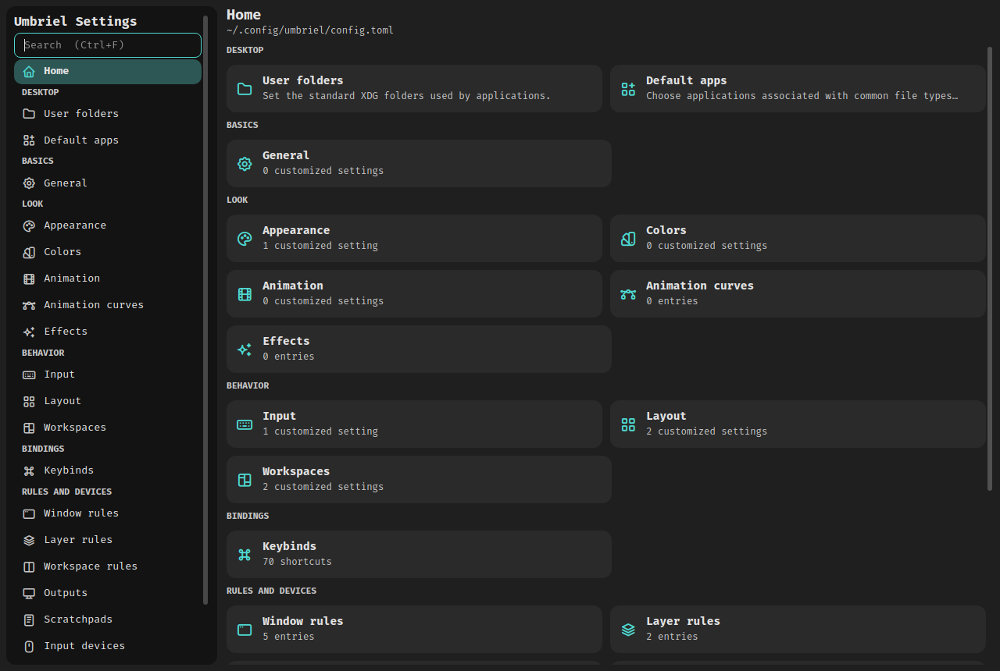

# Umbriel Settings

Edit your [Umbriel](https://github.com/noctalia-dev/umbriel) config, XDG user folders and default
applications without losing the comments and formatting of your files. It comes as a **standalone app**
(PySide6) and as a **[Noctalia](https://github.com/noctalia-dev/noctalia) shell plugin**. Both share the
same core and interface code, so they look and behave alike; the app adds a sidebar and doesn't need Noctalia.

| Standalone app | Noctalia plugin |
| --- | --- |
|  |  |

## Features

- **Every Umbriel setting**: general, appearance, colors, animation and curves, effects, input, layout,
  workspaces and keybinds, plus window, layer, workspace and security rules, outputs, scratchpads, input
  devices and environment variables.
- **Search** (Ctrl+F) over setting names, help text, config keys (`border_width`), rule names and shortcuts.
- **Clear rows**: control, default value (“Default 2”), ⓘ help with the config key and ↶ undo. Like Noctalia's
  settings, a key that differs from the default shows an **Override** badge, and **Reset** (click twice to
  confirm) removes the key so Umbriel's default applies. Units sit next to the number,
  special values such as “Automatic” (-1) have their own switch, and a ↻ glyph marks settings that need an
  Umbriel restart. **Only customized** hides settings at their default.
- **Home** (app) shows the config file, the settings that differ from Umbriel's defaults and the latest
  backups; the sidebar keeps **Customized**, **Backups** and **About** at hand and shrinks to icons in a
  narrow window (widen it again to use the search box).
- **Undo** (Ctrl+Z or the save bar) steps back through unsaved edits, one setting, rule or shortcut at a time.
- **Lists** for rules, devices and effects: edit, name, reorder, duplicate, delete.
- **Outputs** draws the connected displays as numbered tiles at their real size and position. Drag one by its
  number onto an edge of another to place it there: displays snap to each other's center line, so two above a
  main display are centered as a pair, and a corner shifts it half a display that way. The star marks the
  default display (startup focus and XWayland's primary output). Click a display to give it a name for the
  overview and pick its resolution and refresh rate from the modes it reports.
- **Pick from open windows** (window, workspace and security rules) and **Pick from open layers** (layer
  rules) fill a rule's match with an exact pattern such as `^org\.gajim\.Gajim$`, optionally with the
  window's title.
- **Names instead of typing**: an animation's Curve offers your own named Bézier and spring curves next to
  the built-in ones, effect settings offer your effect presets and pools, and output settings (X11 primary
  output, tablet/touch mapping, a rule's output) offer your configured and connected outputs, all still with
  **Custom…**. Curves, presets and pools from your include files count too. **Browse…** picks the files for
  includes, effect shaders (relative to the config when inside its folder) and ICC color profiles.
- **Keyboard layouts**: **Choose…** next to Layout, Variant and XKB options (also for input devices) picks
  layouts in order, a variant for each and options from XKB's own list, and shows the active layout.
- **Keybinds** in groups: build shortcuts from modifier chips, pick actions from a searchable catalog, set
  repeat/locked options, and lock shortcuts against accidental changes. **Run now** (click twice) sends the
  action to Umbriel once so you can see what it does; actions that end the session, close or kill the focused
  window, turn screens off or enter a submap are refused. When an action takes an output, effect preset or
  pool, submap, scratchpad or named workspace, a list offers the ones you have. Drag groups and shortcuts by their
  grip to reorder them, or move them into another group (↑/↓ buttons do the same without a mouse); the
  `[keybinds]` table is saved in that order.
- **User folders and default apps** with folder pickers, a searchable app list and per-MIME-type choices.
- **Follows your theme** (Noctalia or qt6ct/KDE colors, see [Theming](#theming)) and your locale's decimal
  separator.
- **Title bars that follow Noctalia's palette** at an opacity you choose ([details](#title-bar-colors)).
- **About** shows the version and which options of your Umbriel version have no setting yet, and sets the
  editor for **Edit file**.

## Saving safely

Nothing is written until you press **Review & save** (Ctrl+S):

- The review lists every change in words and shows the file diff by section.
- **Check with Umbriel before writing** (on by default; `--no-validate` turns it off) runs
  `umbriel config validate` on a temporary copy. If Umbriel rejects it, nothing is written and each problem
  links to its setting. Skipped when `umbriel` isn't installed.
- **Tidy file layout** regroups the file in canonical order with section banners (may move comments). It is
  on by default only for files that already have banners; `--no-rebuild` turns it off.
- Every save or restore makes a timestamped backup (newest 10 kept). **Backups** compares, restores and
  deletes them; a restore is checked with Umbriel too and warns about problems. User folders, default apps
  and Noctalia's config get their own backups.
- Edits made while a save runs stay unsaved instead of being lost. If user folders save but default apps
  fail (or the other way round), only the part that failed stays pending.
- Unsaved edits are kept as a draft when you close (also on Ctrl+C or logout) and restored next time, unless the
  file changed meanwhile. Edits for another config file are kept until you open that file again.
- The window size (and maximized state) is remembered between runs.
- If the config changes on disk, it is reloaded: setting edits are kept, rule and keybind edits are dropped
  with a note. The app also notices changes to `user-dirs.dirs` and `mimeapps.list`.
- An unexpected UI error is shown in the status bar, and the app clears any stuck “Saving…” or loading state.
- Symlinked files are refused; open the link's target instead.
- The app and the Noctalia plugin save one at a time, and a save is refused if the file changed since it was
  loaded.

## Install

There are two ways to get the app. The `umbriel` command is optional either way; with it, the app shows
defaults and ranges, checks your config before saving and compares its settings with your Umbriel version.

### Option 1: AppImage (easiest)

Download the latest `.AppImage` from the [releases](https://github.com/0rz0rz0rz/Umbriel-Settings/releases).
It bundles Python and every library, so nothing else needs to be installed:

```sh
chmod +x Umbriel-Settings-*.AppImage
./Umbriel-Settings-*.AppImage
```

### Option 2: From source

You need Python 3.11 or newer, PySide6 with QtWebEngine, tomlkit and lupa. First get the code:

```sh
git clone https://github.com/0rz0rz0rz/Umbriel-Settings.git
cd Umbriel-Settings
```

Then install the dependencies with your package manager:

```sh
# Arch Linux
sudo pacman -S python pyside6 qt6-webengine python-tomlkit python-lupa

# Debian 13 or newer
sudo apt install python3 python3-pyside6.qtwidgets python3-pyside6.qtwebenginewidgets \
    python3-pyside6.qtwebchannel python3-tomlkit python3-lupa

# Fedora
sudo dnf install python3 python3-pyside6 python3-tomlkit python3-lupa
```

Package names differ between distributions. If one is missing, use a virtual environment instead; it works
everywhere:

```sh
python3 -m venv .venv
. .venv/bin/activate
pip install -r python/requirements.txt
```

To use the Noctalia plugin instead of (or next to) the app, see [Noctalia plugin](#noctalia-plugin).

## Run

```sh
python python/umbriel-settings.py [path/to/config.toml]
```

Without a path it opens the config used last, else `~/.config/umbriel/config.toml` (switch files at the
bottom of the home page). Options: `--config PATH`, `--no-validate`, `--no-rebuild`, `--check-schema`
(compare the app's fields with your Umbriel and exit), `--version`. Keys: Ctrl+F search, Ctrl+S review,
Ctrl+Z undo (outside text fields), Alt+Left back, Esc clears the search or goes back.

Only one window runs at a time: starting the app again brings the open window to the front and opens the
config given on the command line, unless the current one has unsaved changes.

**Launch with a keybind** (in `[keybinds]` or on the Keybinds page; replace `/home/you`, quote paths with spaces):

```toml
# From a checkout (with a virtual environment, use .venv/bin/python instead of /usr/bin/python3)
"Mod+Shift+C" = "spawn /usr/bin/python3 /home/you/Applications/Umbriel-Settings/python/umbriel-settings.py"
# From the AppImage
"Mod+Shift+C" = "spawn /home/you/Applications/Umbriel-Settings-<version>-x86_64.AppImage"
# Works for any install: the desktop entry the app creates on first start
"Mod+Shift+C" = "spawn gio launch /home/you/.local/share/applications/umbriel-settings.desktop"
```

**AppImage build**: `appimage/build-appimage.sh` writes `dist/Umbriel-Settings-<version>-<arch>.AppImage`
(needs network, `python3` with `venv`, `curl`, `readelf` from binutils, and FUSE or `APPIMAGE_EXTRACT_AND_RUN=1`). Every
download is checked against the SHA-256 checksums in `appimage/` (`*.lock`, `pins.sh`) before use; after changing
`python/requirements.txt`, regenerate them with `python tools/update_appimage_pins.py`. The desktop entry points
at the AppImage, so keep it at a stable path.

**Upgrading from `umbriel-config-gui`** (the old name): data moves to `$XDG_DATA_HOME/umbriel-settings`
automatically, and the desktop entry is replaced. Files earlier versions kept next to the config (rule names,
keybind locks, backups) move into the data folder the first time each config is opened. By hand: point keybinds at `python/umbriel-settings.py`,
and change the Noctalia palette template's `output_path` (see below); until then the old palette file is
still read.

## Theming

The app uses the first available source and follows changes live:

1. **Noctalia's palette** (exact plugin colors). **About → Set up palette template** installs it for you
   (backing up `noctalia-config.toml`). By hand: save this as
   `~/.config/noctalia/templates/umbriel-settings-palette.conf`

   ```text
   # Written by Noctalia for Umbriel Settings; regenerated on every theme change.
   <* for name, value in colors *>
   {{ name }}={{ value.default.hex }}
   <* endfor *>
   ```

   and add to `~/.config/noctalia/noctalia-config.toml` (use full paths if your Noctalia doesn't expand
   `$XDG_CONFIG_HOME`):

   ```toml
   [theme.templates.user.umbriel_settings]
   input_path = "$XDG_CONFIG_HOME/noctalia/templates/umbriel-settings-palette.conf"
   output_path = "$XDG_CONFIG_HOME/umbriel-settings/noctalia-palette.conf"
   ```

2. **The qt6ct color scheme** (`color_scheme_path` in `~/.config/qt6ct/qt6ct.conf`, e.g. Noctalia's
   `noctalia.colors`).
3. **Your desktop's Qt palette.**

Font and corner roundness come from `font_family` and `corner_radius_scale` in Noctalia's `[shell]`. The
app's own dialogs also follow qt6ct's style, font, icons and colors when `QT_QPA_PLATFORMTHEME` is
`qt6ct`/`qt5ct` (needed in the AppImage); `UMBRIEL_QT_THEME=none` disables that, `=qt6ct` forces it.

### Title-bar colors

Umbriel draws the title bars of server-side decorated windows (`prefer_no_csd = true`) from
`[colors.title_bar]`. On **Colors → Title bar**, **Background** and **Background unfocused** have an
**Opacity** slider (stored as the color's alpha: 0.84 → `D6`) and two buttons:

- **KDE**: Noctalia's `primary_container` (focused) / `surface` (unfocused), like KDE window decorations.
- **KDE header**: `surface_container` / `surface`, like KDE headers.

A button makes the color **follow Noctalia**: it is queued as a normal edit, and after you save, every
palette change updates it, even with the app closed. A fixed color or the unlink button stops following.
Each config file follows on its own.

How it works: a Noctalia user template (`~/.config/noctalia/templates/umbriel-titlebar.toml`, entry
`umbriel_titlebar`) renders the colors to `~/.config/umbriel-settings/titlebar-colors.toml` and runs
`titlebar_apply.py`, which copies them into `[colors.title_bar]` of each following config and changes nothing
else. (An include can't do it: Noctalia's built-in umbriel template always loads `noctalia.toml` last.)

## Desktop settings

**User folders** are stored in `$XDG_CONFIG_HOME/user-dirs.dirs`, **default apps** in the
`[Default Applications]` section of `$XDG_CONFIG_HOME/mimeapps.list` (custom desktop-file IDs work too).
Other entries and comments are kept. Folders are recorded, not created or moved.

## Noctalia plugin

The plugin opens the same interface in a Noctalia panel, with a bar button that turns your accent color while
edits are unsaved, and shares backups, rule names and keybind locks with the app. Setup:
[plugin README](noctalia-plugin/README.md); usage and troubleshooting:
[plugin user README](noctalia-plugin/umbriel-settings/README.md).

**Install** (until it's in Noctalia's community plugins): clone this repository, install `python-tomlkit`,
then add the repository's `noctalia-plugin` folder as a local plugin source and enable the plugin. Replace
`/path/to` with where you cloned it:

```sh
git clone https://github.com/0rz0rz0rz/Umbriel-Settings.git
noctalia msg plugins source add umbriel-settings path /path/to/Umbriel-Settings/noctalia-plugin
noctalia msg plugins enable 0rz0rz0rz/umbriel-settings
```

The plugin runs from the checkout, so `git pull` updates it (then `noctalia msg config-reload`).

Add the **Umbriel Settings** widget from Noctalia's Settings → Bar, or toggle the panel from a terminal or
keybind (the plugin adds no shortcut of its own; pick a free combo):

```toml
[keybinds]
"Mod+Shift+S" = "spawn noctalia msg panel-toggle 0rz0rz0rz/umbriel-settings:folders"
```

## Files

`$XDG_DATA_HOME` defaults to `~/.local/share`, `$XDG_CONFIG_HOME` to `~/.config`.

| Path | Contents |
| --- | --- |
| Your Umbriel config | Saved changes; custom keybind groups are TOML comments |
| `$XDG_DATA_HOME/umbriel-settings/` | `gui-config-path` (last config), `configs/<id>/` (backups, rule names, keybind locks), `backups/` (user folders, default apps), `noctalia-backups/`, `app-ui/` (drafts, cache, icons, `window.json` with the app window size), `editor-command` |
| `$XDG_CONFIG_HOME/umbriel-settings/` | `noctalia-palette.conf` (from Noctalia), `titlebar-colors.toml`, `titlebar_apply.py`, `*.titlebar.bak` (config before the script's last change) |
| `$XDG_CONFIG_HOME/noctalia/templates/` | `umbriel-settings-palette.conf`, `umbriel-titlebar.toml` (entries in `noctalia-config.toml`) |
| `$XDG_DATA_HOME/applications/umbriel-settings.desktop`, `…/icons/hicolor/128x128/apps/umbriel-settings.png` | Desktop entry and icon |

Custom icon: replace `python/umbriel_settings/assets/icon.png` with your own PNG (transparency is kept), or delete it
and add `icon.jpg`/`icon.jpeg`. The first of `icon.png`, `icon.jpg`, `icon.jpeg` that exists is used; the built-in
icon is used if none exists or the file is invalid.

## Versions

| Item | Version |
| --- | --- |
| App (`python/umbriel_settings/__init__.py`) | `0.1.0-006` |
| AppImage (latest release) | `0.1.0-006` |
| Noctalia plugin (`plugin.toml`) | `0.1.6` |

The app version is `<Umbriel version>-<revision>`; each build raises the revision, which restarts at `001`
when Umbriel's version changes. The plugin uses plain `MAJOR.MINOR.PATCH` (`0.1.0-006` → `0.1.6`).

## Development

```text
python/umbriel_core/               Shared logic: fields, schema, TOML edits, rules, keybinds, desktop files, backups, theme
noctalia-plugin/umbriel-settings/  lib/ ui/ pages/ (shared Luau UI), umbriel_settings.py (commands over the core),
                                   panel.luau + bar.luau (plugin), app.luau (app layout)
python/umbriel_settings/           The app: lupa runs the Luau UI (host/runtime.py), a web view draws it (host/web/)
appimage/  tools/  tests/  noctalia-plugin/tests/
```

```sh
python tools/check.py            # checks for your changed files, one line each
python tools/check.py all        # core, plugin (CPU budget, Lua/Luau parse), app host (web render), schema, ruff, shellcheck
python tools/sync_plugin_core.py # after editing python/umbriel_core (the plugin bundles a copy)
```

CI runs the same checks on Python 3.11, 3.12 and 3.13, except the two that need Umbriel or Noctalia installed
(schema coverage and the plugin lint; `check.py` reports those as skipped). Dependency ranges and lint
settings: `pyproject.toml`; AppImage pins: `python/requirements.txt` (checksums: `appimage/requirements.lock`). Icons: [Tabler Icons](https://tabler.io/icons)
(MIT, license in `host/web/fonts/`).

## License

MIT, see [LICENSE](LICENSE).

> **Disclaimer:** This project was created entirely by AI.

## Related projects

- [Umbriel](https://github.com/noctalia-dev/umbriel): the Wayland compositor this app configures.
- [Noctalia](https://github.com/noctalia-dev/noctalia): the shell the plugin runs in and whose theme the app follows.
