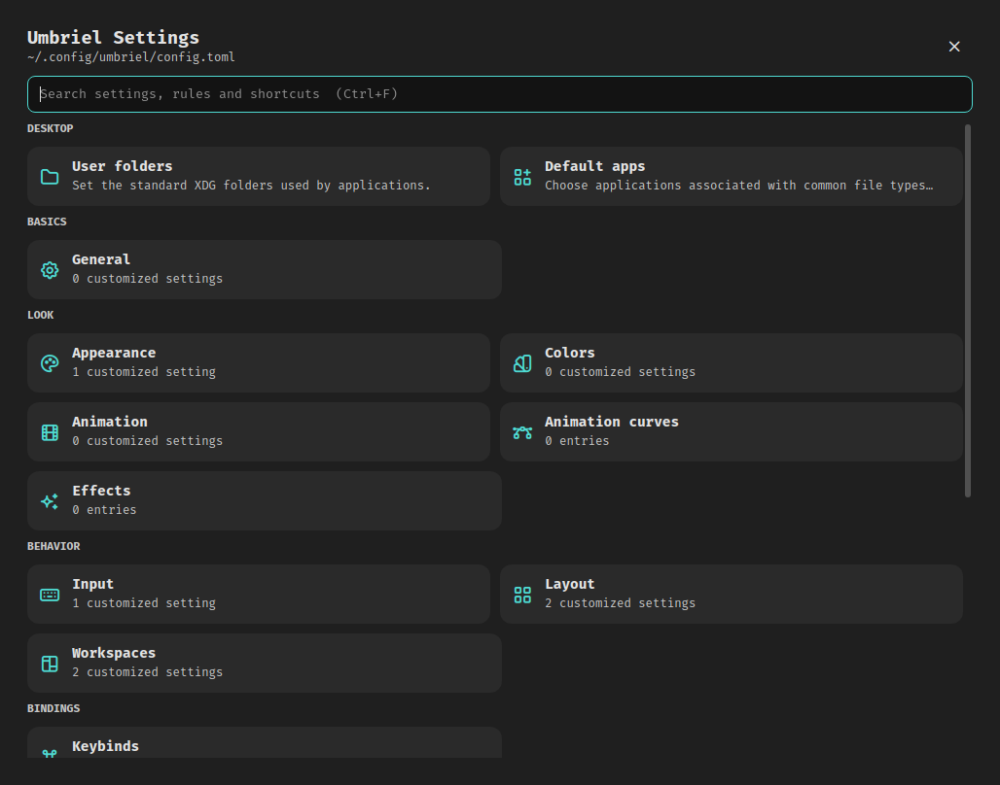
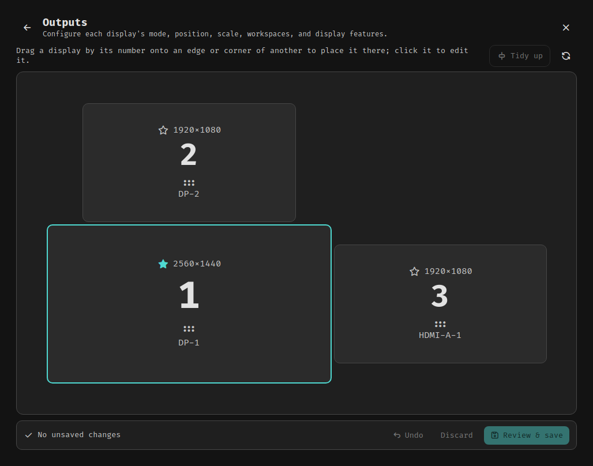

# Umbriel Settings

Edit your whole Umbriel configuration from a Noctalia panel without losing the comments and formatting of
your config: every setting page, window/layer/workspace/security rules, outputs, scratchpads, input devices,
effects, animation curves, environment variables and keybinds, plus XDG user folders and default apps.
The same interface also runs as a standalone app: see the
[Umbriel-Settings repository](https://github.com/0rz0rz0rz/Umbriel-Settings).



## Plugin

| Field | Value |
| --- | --- |
| ID | `0rz0rz0rz/umbriel-settings` |
| Entries | Bar widget: `settings`; panel: `main` |
| Version | `0.2.1` |
| Made for Umbriel | `0.1.0` |
| Needs Noctalia | `5.4.0` or newer (plugin API 43) |

## Requirements

- Noctalia 5.4.0 or newer (plugin API 43) and `python3` 3.11+ (runs the bundled helper).
- `python-tomlkit`: edits the config while keeping its formatting. Without it the panel says what to
  install; user folders and default apps still work.
- `umbriel` on `PATH`: defaults, ranges, validation before saving, the **Outputs** display arrangement and
  mode lists, **Pick from open windows/layers**, **Use the focused window**, live refresh (`umbriel subscribe`)
  and **Run now**.
  Without it settings can still be edited, but aren't checked before writing.
- Optional: `gio` (open the standalone app), `xdg-open` or an
  editor command set under **About** (**Edit file**; `xdg-open` also opens the cursor theme folder), and `notify-send` (the message when a display **Try**
  went back on its own while the panel was closed). Buttons explain what's missing.
- Optional: internet access for **Community shaders** (Effects page) and the **Cursor themes** store, only when
  you browse or download them.

## Usage

Add the **Umbriel Settings** widget (`settings`) to a bar from Noctalia's Settings → Bar: it toggles the
panel and turns your accent color while edits are unsaved. Or toggle the panel from a terminal or script:

```sh
noctalia msg panel-toggle 0rz0rz0rz/umbriel-settings:main
```

**Open with a keybind**: the plugin adds no shortcut of its own; bind the command in Umbriel, under
`[keybinds]` in your config or as a `spawn` action on the panel's Keybinds page (pick a free combo):

```toml
[keybinds]
"Mod+Shift+S" = "spawn noctalia msg panel-toggle 0rz0rz0rz/umbriel-settings:main"
```

- **Home** has a search over setting names, help text, config keys (`border_width`), rule names and
  shortcuts, cards for every page with customized/unsaved counts, and **Customized**, a list of every
  setting that differs from Umbriel's default.
- **Setting rows** show the control, the default (“Default 2”), ⓘ help with the config key (with a copy
  button) and undo. Like
  Noctalia's settings, a key that differs from the default shows an **Override** badge, and **Reset** (click
  twice to confirm) removes the key so Umbriel's default applies. Units sit next to
  the number, special values such as “Automatic” (-1) have their own switch, and ↻ marks settings that need
  an Umbriel restart. **Only customized** hides settings at their default; the filter box narrows a page to
  matching settings, and an open group can undo its unsaved edits at once.
- **Rules, devices and effects** are lists (the filter also matches values): edit, name, reorder, duplicate,
  delete. **Pick from open windows** / **Pick from open layers** on a rule fill its match (app id, optionally
  title, or layer namespace) with an exact pattern from what Umbriel shows, and follow windows opening and
  closing; **Use the focused window** takes the focused window's app id.
- **Outputs** shows the connected displays as numbered tiles at their real size and position, filling the
  page. Drag a display by its number (the grip under it) onto an edge of another to place it there, or onto a
  top or bottom corner to place it above or below but shifted half a display that way: displays stay centered on
  each other, and the layout starts at 0, 0 (a display's Position fields set it by hand). **Tidy up**
  recenters after a mode or scale change. The star on a tile marks the default display (click a grey star to
  move it there, the filled one to clear it): it gets the focus at startup (`focus_at_startup`) and is
  XWayland's primary output. Click a display's number to edit it: a name for the overview (kept beside the
  config, not in it), and a Mode picked as Resolution and Refresh rate from the modes Umbriel reports (a
  display without an entry gets one, dropped again if you leave without changing anything). Identical
  monitors that report the same name are told apart by connector. Entries for outputs that aren't connected
  are listed under **Not connected**. Moving displays or picking the default changes nothing on disk until you
  save; then each display's `position` (and `focus_at_startup`) is written to its `[output."…"]` entry.
  **Try** saves display changes right away and asks to keep them (the question stays on top of every page);
  without an answer within 15 seconds the previous file comes back and the changes are unsaved again, also
  when the panel was closed meanwhile. Before anything is written, the helper starts a small watcher (system
  `python3`) that restores the previous file 30 seconds after the save unless you pressed Keep or Go back,
  so the file comes back even if Noctalia stops, also in the middle of the save (not if the session ends: logout or reboot); if the config was
  edited meanwhile it is left alone and you are told. The Backups page won't delete the backup a Try goes back
  to until it ends. Saving waits until the Try is answered. The tiles follow monitors being plugged in or out.

  
- **Curve, effect and output settings** offer your own named curves, effect presets and pools (also from
  include files) and your configured and connected outputs; **Browse…** picks include files, effect shaders
  and ICC profiles in a file browser of its own (the panel stays above other windows), and for autostart
  commands lists the installed apps like the default apps do. A keybind action's first argument (output,
  preset, pool, submap, scratchpad, named workspace) has a list too.
- **Community shaders** (bottom of the **Effects** page): Noctalia's
  [community-umbriel-shaders](https://github.com/noctalia-dev/community-umbriel-shaders) catalogue by kind
  (window, border, screen, cursor, animation), with a preview (click it for a large one), author, license and
  tags per effect. Nothing is
  downloaded until you press **Browse community shaders** (never in Noctalia's offline mode); scrolling to the
  end of the list shows 6 more, and a line under the kinds explains the two buttons for that kind.
  **Use** downloads an effect and turns it on: its include and its settings (for example `[effects] window`
  for every window, or the events an animation was made for) go into your unsaved edits, and the effect of its
  kind that was on before is dropped, so saving deletes it (unless something else, such as a window rule,
  still picks it). Animation effects for different events work side by side. **Install** only adds an
  effect, so you can pick it for single apps under **Window rules**, for one display under **Outputs**, or
  in an effect pool ("Picked in your settings" then shows on it). **Remove** takes an effect out again,
  **Remove all** next to the kinds every effect of the shown kind, and a check on a kind shows that one of
  its effects is in use; all of it is undone like any other edit. The files land in `shaders/community/` next to your config only when you save, as the
  repository's own instructions install them, and a later save that no longer includes an effect removes them.
- **Cursor themes**: the cursor Theme opens a list of the installed themes with a preview strip of their
  shapes and **Refresh**. **Browse cursor themes…** (a button at the end of the list) opens a page with the X11 cursor themes of
  the Pling store (gnome-look.org, store.kde.org; the store KDE's "Get New Cursors" uses): sorted by downloads,
  rating, date or name, a search, previews (click for a large one), more as you scroll. These are community
  uploads nobody reviews, so a download is checked against the store's MD5, only Xcursor images and
  `index.theme` are kept and nothing from it is run; themes KDE hides from its store are left out. **Download**
  puts it into the private cache, **Use** picks it, and it is copied into `~/.local/share/icons/` only when you
  save (Review says so). Every theme in your home folder (`~/.icons`, `~/.local/share/icons`) and every download
  gets a remove button in the Theme list (and on the store page), which the next save carries out: for themes it
  installed only their unchanged files, for others the whole theme folder (or only `cursors/` of an icon theme
  that also has cursors), and the download. Never the theme in use or Umbriel's default (`default` and the
  themes it inherits); themes your system installed stay disabled (remove their package). The list is read again
  each time it opens and after a save, so themes added or deleted meanwhile show up right away.
  **Browse folder** (store page, and a folder button in the Theme list) opens `~/.local/share/icons/` in your file
  manager.
- **Keyboard layouts**: **Choose…** next to Layout, Variant and XKB options picks from XKB's list.
- **Keybinds** are grouped (shortcuts used twice show **conflict**): build shortcuts from modifier chips (the
  standalone app can also **Record…** a key press), pick actions from a searchable catalog,
  lock shortcuts against accidental changes. **Run now** (click twice) sends the action to Umbriel once;
  it refuses `session-quit`, closing or killing the focused window, screens off, disabling outputs, the
  shortcut inhibitor, entering a submap and `spawn noctalia msg session …` (other commands you spawn run as
  written). Window actions act on the window behind
  the panel. Drag groups and shortcuts by their grip to reorder them or
  move a shortcut into another group (↑/↓ buttons on the group list and a shortcut's page do the same);
  the `[keybinds]` table is saved in that order.
- **User folders** and **Default apps** edit `user-dirs.dirs` and `mimeapps.list`.
- **Icon theme** (Desktop) lists the installed icon themes with six of their icons; saving writes the pick
  into GNOME settings and the GTK/Qt/KDE files that exist (see Files written). The trash button deletes a
  theme from your home folder on save, never the one in use, one it builds on, or one that also holds a
  cursor theme; system themes go with their package. **Browse icon themes…** opens a store page like the
  cursor one (sorts, search, previews, more as you scroll) that downloads nothing: **Open page** opens the
  theme's Pling page in your browser, and you extract it into `~/.local/share/icons/` (**Browse folder**).
- **Cursor theme sync**: a save whose config sets a cursor theme also gives it (and the size) to GTK, Qt/KDE
  and X11 apps that draw their own cursor (Review says so; not with “Umbriel default”, not during a **Try**).
- **Title-bar colors**: on Colors → Title bar, **KDE** / **KDE header** make a background follow Noctalia's
  palette at the chosen opacity. Like any edit this is queued: Review lists it, Discard and Undo drop it,
  and only the save starts following; afterwards palette changes update it even with the panel closed. A
  fixed color or **Stop following** stops it, also with the next save. Each config follows on its own.
- **About** shows the version, the Umbriel and Noctalia versions it is made for (and notes when your Umbriel
  differs), options your Umbriel has that aren't covered yet, and the editor command.

Nothing is written until **Review & save** (Ctrl+S, again to save): the review lists every change with
**Revert**, shows the diff and runs
`umbriel config validate` first; if Umbriel rejects the file, nothing is written and each problem links to
its setting. Unsaved edits (including folders and default apps) survive closing the panel and restarting
Noctalia as a draft; edits for another config file wait until that file is open again. Edits made while a
save runs stay unsaved instead of being lost.

Keys: Ctrl+F search, Ctrl+S review (again: save), Ctrl+Z undo the last unsaved edit and Ctrl+Y redo (also
in the save bar), Alt+Left back, Esc close.

## Settings

| Setting | Type | Default | Description |
| --- | --- | --- | --- |
| `display` | `select` | `icon` | What the bar widget shows: `icon`, `icon_text` or `text`; the icon (the text in `text`) takes the accent color while edits are unsaved. A vertical bar always shows only the icon. |
| `icon` | `select` | `moon-stars` | The bar widget's icon: `settings`, `settings-2`, `settings-cog`, `adjustments-horizontal`, `adjustments-cog`, `tool`, `tools`, `moon`, `moon-stars`, `moon-2` or `home-cog`. Unknown values fall back to `moon-stars`. |

## Troubleshooting

- **"python3 was not found"**: install Python 3.11+ so `python3` is on the `PATH` Noctalia was started with.
- **"Python's tomlkit module is missing"**: install `python-tomlkit` (or `pip install --user tomlkit`) and
  reopen the panel. User folders and default apps work without it.
- **"The umbriel command was not found; the config was not validated"**: the panel can't find `umbriel` on
  Noctalia's `PATH`, so it shows no defaults or ranges and can't check the file before saving. Fix the
  `PATH` Noctalia is started with.
- **"… is a symlink; edit its target directly"**: the plugin never writes through a symlinked config,
  `user-dirs.dirs`, `mimeapps.list` or GTK/Qt settings file (a symlinked one is skipped with a warning). For the config, enter the link's target path on Home instead.
- **Rule, curve or keybind edits disappeared**: the config changed on disk while they were unsaved (another
  editor, the app, a dotfile sync). Setting edits are kept; list edits are dropped so they can't overwrite
  the new file.
- **Widget or panel missing after an update**: run `noctalia msg config-reload`. Errors from the helper are
  shown in the panel; Noctalia's own log is `~/.cache/noctalia/noctalia.log`.

## Notes

- **Look**: colors, font and Noctalia's own controls come from the shell; the panel's cards and rows also
  follow **Corner roundness** (`[shell] corner_radius_scale`, read with `noctalia.getSetting`), live.
- **Files read**: the Umbriel config (last chosen in the panel or app, else `~/.config/umbriel/config.toml`),
  `user-dirs.dirs`, `mimeapps.list`, installed `.desktop` files, qt6ct/KDE color files (KDE title-bar colors),
  the icon and cursor theme settings (`gsettings get`, GTK 2/3/4, qt5ct/qt6ct, `kdeglobals`, `kcminputrc`,
  `~/.icons/default/index.theme`), the icon themes in `~/.icons`, `$XDG_DATA_HOME/icons`, `$XDG_DATA_DIRS/icons`,
  `noctalia-config.toml` and the palette file (title bars that follow Noctalia), XKB's
  `rules/evdev.lst` (keyboard layout picker; `$XKB_CONFIG_ROOT` or `/usr/share/X11/xkb`) and the files your
  config includes (`[include]`, for the effect presets, pools and curves they define), and the cursor themes in
  the cursor search path (`$XCURSOR_PATH`, else `~/.icons`, `$XDG_DATA_HOME/icons`, `$XDG_DATA_DIRS/icons`,
  `/usr/share/pixmaps`) for their previews.
- **Files written** (atomically, symlinked user files refused; only the panel's drafts and helper requests go
  through Noctalia's plain `writeFile`):
  - on **Save**, **Try**, **Restore** and the Try's own rollback: the Umbriel config (validated),
    `$XDG_CONFIG_HOME/user-dirs.dirs` and `$XDG_CONFIG_HOME/mimeapps.list` (other entries and MIME fallbacks
    kept), each after a timestamped backup;
  - on **Save** with an icon theme picked, or a config that sets a cursor theme other apps don't use yet:
    `gsettings set org.gnome.desktop.interface …` and only the theme lines of the GTK 2/3/4, qt5ct/qt6ct,
    `kdeglobals`, `kcminputrc` and `~/.icons/default/index.theme` files that exist (GTK 3's `settings.ini` is
    created when no GTK file exists), each after a backup into `backups/toolkit/<file>/`; a symlinked file is
    skipped with a warning, the others are still written;
  - whenever **Review** checks pending edits (and before each save): a temporary owner-only copy
    `.umbriel-settings-*.toml` next to the config (in `configs/<id>/` below when that folder is read-only) for
    `umbriel config validate`, removed right after; a later save removes leftovers of a killed one (only these
    names and the `.<config name>.*.tmp` files of atomic writes) once they are 10 minutes old;
  - in `$XDG_DATA_HOME/umbriel-settings/` (owner-only, 0700; files 0600): those backups (`configs/<id>/backups/`
    per config, `backups/` for the desktop files, `noctalia-backups/` for Noctalia's config; newest 10 per file,
    the Try watcher may add one until the next save prunes), rule and display names (`gui-labels.json`) and
    keybind locks per config, `configs/<id>/trial.json` while a **Try** waits for an answer and
    `trial.result.json` (what its watcher did), the last chosen config (`gui-config-path`, written when you
    switch), the editor command (**About**), `write.lock` (one writer at a time: panel, app, Try watcher and
    title-bar script), the cursor theme previews (`cursor-previews/`, redrawn when a theme changes), downloaded
    cursor themes (`cursor-downloads/pling-<id>-<file>/`, only cursor images and `index.theme`), the store's
    previews (`cursor-store/previews/`) and the
    `.migrated-v1` / `.private-v1` markers of one-time migrations;
  - in Noctalia's plugin data directory: drafts (`draft.json`, `draft-other-config.json`), the helper's
    request/response files (`run/`; pairs left by a plugin unload are removed after 10 minutes), its bytecode cache (`pycache/`) and the field catalog (`cache/`);
  - title bars that follow Noctalia, see below.
- **Community shaders**: **Browse**, **Use** and **Install** download into
  `$XDG_DATA_HOME/umbriel-settings/community/` only (the catalogue, previews and the effect's files, each
  checked against the catalogue's SHA-256). A **Save** whose config includes an effect from
  `shaders/community/` copies its files (and those of effects it needs, such as a border's overlay) next to the
  config, before writing the config, after listing them in `shaders/community/.umbriel-settings.json`. Only
  files listed there are ever removed, by a later save (or **Restore**) that no longer includes them; a file you
  changed is kept, nothing is removed while a **Try** can still go back, and a `shaders/community` git checkout
  is never written. **Restore** puts back files a restored backup includes, from that cache.
- **Cursor themes**: a **Save** that picks a downloaded theme copies it into `$XDG_DATA_HOME/icons/<theme>/`
  (else the first `$XCURSOR_PATH` folder in your home) before writing the config, after listing its files in
  `<theme>/.umbriel-settings.json`; a folder of that name it didn't install is never touched (the save is refused).
  A save with a queued removal deletes the theme after writing the config (a folder is first renamed to a hidden
  `.umbriel-settings-removing-…` name, so a kill halfway leaves nothing a cursor lookup finds; swept later).
  Downloads from an older version of the extraction are deleted from the cache when the list is read.
- **Title bars that follow Noctalia**, only when a save starts following (**KDE** / **KDE header**): the user
  template `~/.config/noctalia/templates/umbriel-titlebar.toml`, its `umbriel_titlebar` entry in
  `noctalia-config.toml` (backed up first; refused when Noctalia saved it meanwhile) and
  `~/.config/umbriel-settings/titlebar_apply.py` (replaced by a newer one on a later save). On palette changes Noctalia renders
  `~/.config/umbriel-settings/titlebar-colors.toml` and runs the script, which sets only `background` /
  `background_unfocused` in `[colors.title_bar]` of each following config (an include can't, because
  Noctalia's umbriel template always loads `noctalia.toml` last). It writes while holding the same
  `write.lock`, starts over when the config changed meanwhile, and keeps the config's previous version as an
  owner-only `*.titlebar.bak` next to itself.
  **To stop**, set a fixed color (or press **Stop following**) on every field that follows and save: once no
  config follows any more, the entry, the template, the rendered file, the script and its `*.titlebar.bak`
  copies are removed (the configs keep their last colors). **Disabling the plugin** does the same for every
  config (`onExit`, helper `titlebar-cleanup`); this also stops following set up in the standalone app. When
  `noctalia-config.toml` can't be changed (a symlink, or no `python-tomlkit` after following was set up in the
  AppImage), disabling still removes the script, the rendered file and the copies, so nothing rewrites a config
  any more, and a notification names the entry and the template to remove by hand.
  **Uninstalling** tries the same, but only on a best-effort basis: Noctalia may remove the plugin folder before
  the helper has loaded, so disable the plugin first, then uninstall. If the cleanup couldn't run (for example
  the plugin was removed directly or python3 was gone), delete
  `[theme.templates.user.umbriel_titlebar]` from `noctalia-config.toml`,
  `~/.config/noctalia/templates/umbriel-titlebar.toml`, `titlebar-colors.toml`, `titlebar_apply.py` and
  `*.titlebar.bak` in `~/.config/umbriel-settings/` by hand.
- **Processes**: `python3 umbriel_settings.py <command>` (JSON request/response files and the helper's
  bytecode cache in the plugin data directory); `umbriel config validate` (on a temporary `.umbriel-settings-*.toml` next to the config,
  removed afterwards), `umbriel config schema --json`, `umbriel outputs --json`, `umbriel windows --json`, `umbriel layers --json`,
  `umbriel keyboard-layouts --json`, `umbriel subscribe <events>` (live refresh: each ends after at most 30 s or
  the first change and is asked again while a page that shows live state is open; two at most at a time). The
  schema is read when the panel first opens, validation runs when **Review** opens, and a **Try** countdown asks
  the helper to wait one second at a time. On button press only: `umbriel focused-window --json` (**Use the
  focused window**), `umbriel msg <action>` (**Run now**; for a `spawn …` action Umbriel runs that command
  through its shell), `gio launch` (starts the installed standalone app), `xdg-open` (your default app for
  `.toml` files, and your file manager for the cursor theme folder on **Browse folder**) or your editor command. **Try** starts a detached watcher, the system's
  `python3 -I -c <umbriel_core/trial.py>`, that ends once the Try is answered or about 30 s after it started
  (longer only while another save holds `write.lock`, at most about 6 minutes), and `notify-send` when it went
  back or couldn't. Noctalia runs `python3 titlebar_apply.py` after palette changes while a title-bar color
  follows it, and the plugin runs helper `titlebar-cleanup` when it is disabled (on uninstall: best effort;
  `notify-send` when it couldn't finish).
- **Network**: only on request, from the **Effects** page: `raw.githubusercontent.com/noctalia-dev/community-umbriel-shaders`
  (the catalogue on **Browse** or refresh, the shown effects' previews, an effect's files on **Use** or **Install**), by
  the helper (Python's `urllib`), skipped in Noctalia's offline mode. And from the **Cursor themes** page, only
  after **Browse cursor themes**: the store listing and item records from `api.pling.com`, previews from
  `images.pling.com`, a theme's archive on **Download** from `files*.pling.com` (which redirects to its file host),
  also skipped in offline mode, and the same listing and previews for the **Icon themes** page (which downloads
  nothing; **Open page** hands a `www.pling.com/p/<id>/` link to `xdg-open`, your browser); Pling sees these
  requests like any visit to its sites. Nothing else.
- **Left behind on uninstall**: `$XDG_DATA_HOME/umbriel-settings/` (the backups and small state files above,
  shared with the standalone app) and Noctalia's plugin data directory (drafts); remove them by hand if you
  don't use the app. Community shaders stay in `shaders/community/` next to your config, which may still
  include them: to remove them by hand, delete their `shaders/community/…` entries from `[include] files` (or
  press **Remove** on each and save), then delete the `shaders/community/` folder. Cursor themes it installed stay
  in `~/.local/share/icons/<theme>/` (marked by `.umbriel-settings.json`), since other apps may use them: remove
  them first with the remove button and a save, or by hand with `rm -r ~/.local/share/icons/<theme>`.
- `umbriel_core/` is the config library shared with the standalone app, bundled so the plugin works alone.
  `app.luau` is the app's layout; it isn't in `plugin.toml`, so Noctalia never loads it.
- MIT License; see `LICENSE`.
